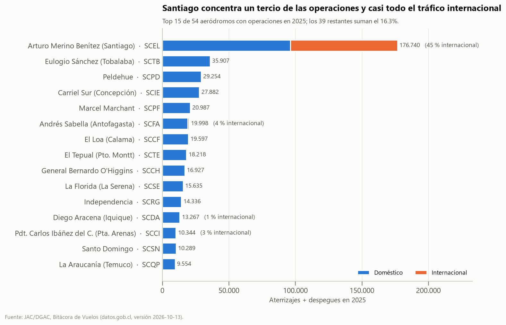
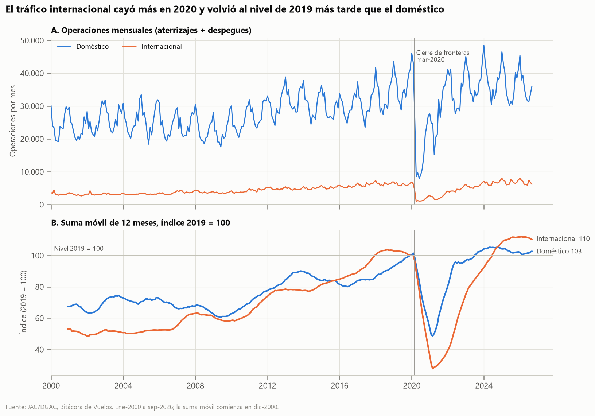
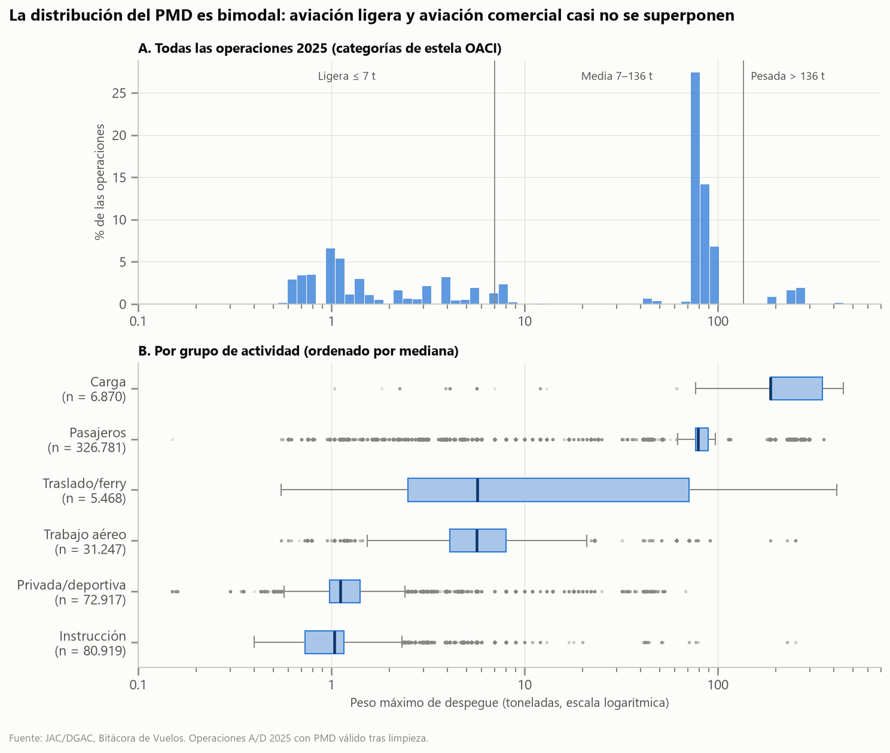
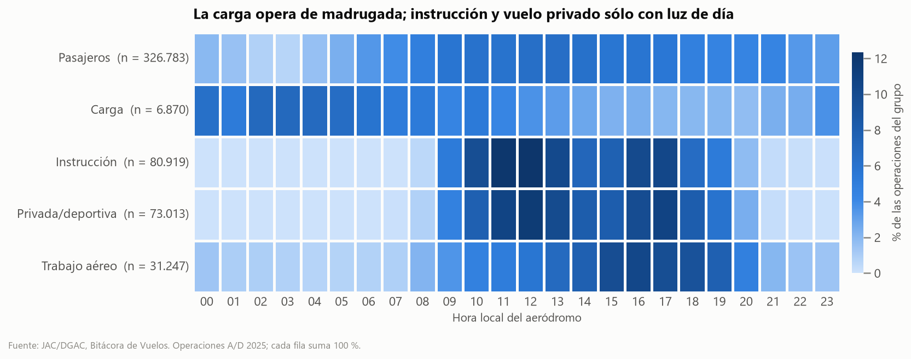
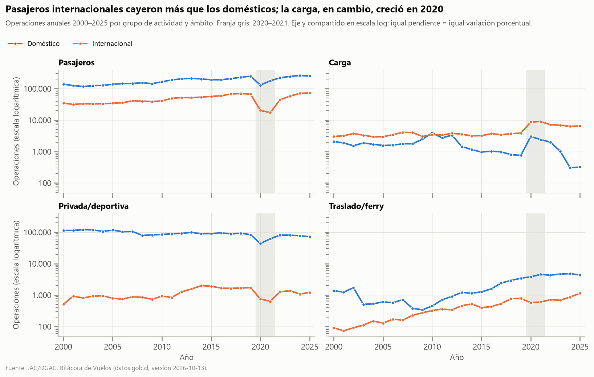
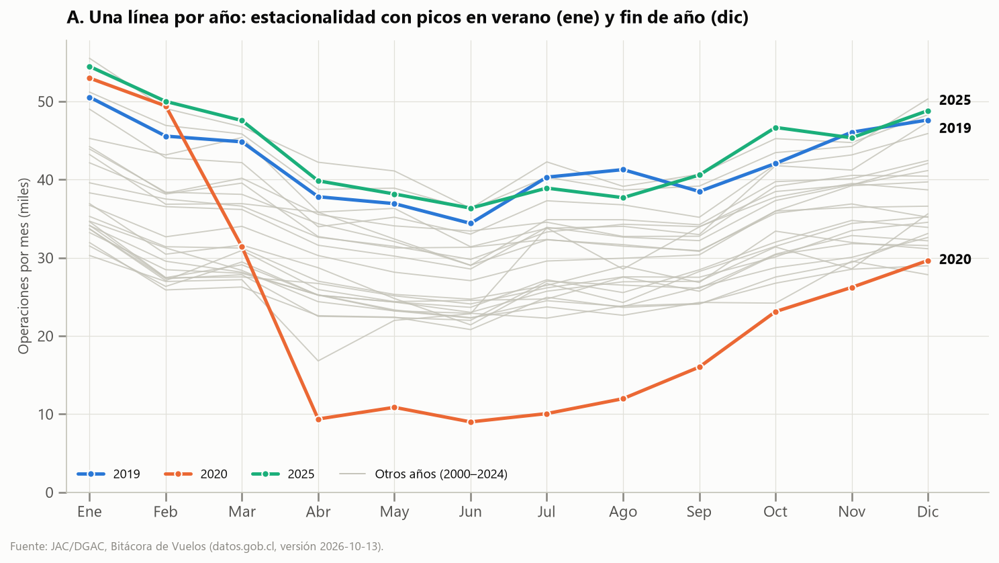
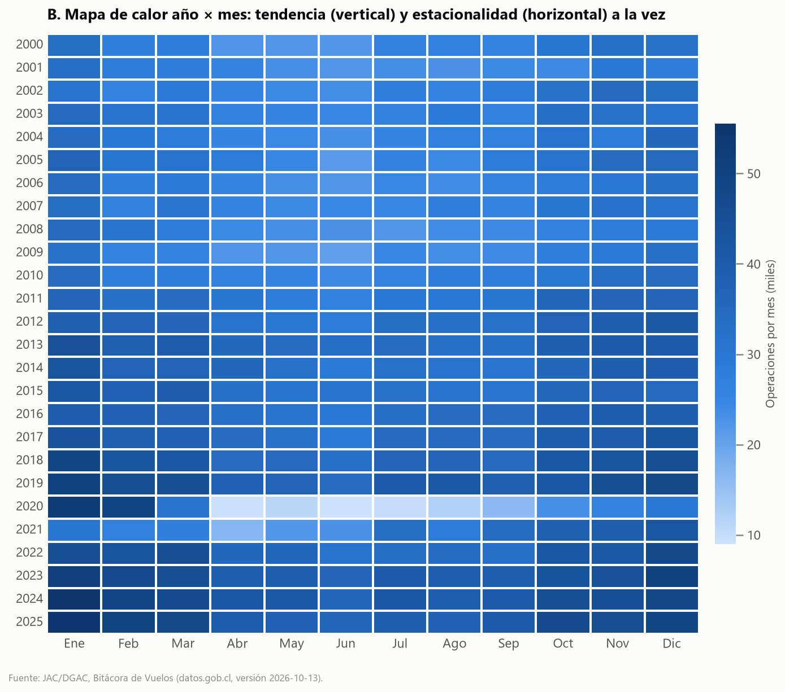

# Evaluación 2 - Visualización de Datos de Transporte

Estudio exploratorio y visual de las **operaciones de aeronaves en aeródromos de Chile (2000–2026)** a partir de datos abiertos de la Junta de Aeronáutica Civil (JAC). Todo el proceso (adquisición, calidad, preparación, transformaciones, visualización y validación) es reproducible con Python.

- Notebook principal: [`notebooks/evaluacion02.ipynb`](notebooks/evaluacion02.ipynb) (se ejecuta de principio a fin en orden)
- Investigación de la fuente: [`docs/01_investigacion_fuente.md`](docs/01_investigacion_fuente.md)
- Clasificación de variables: [`docs/dimensionalidad.csv`](docs/dimensionalidad.csv)

## Problema

**Pregunta principal.** ¿Cómo se distribuye y cómo ha evolucionado entre 2000 y 2026 la actividad de aterrizajes y despegues informada por la DGAC, según aeródromo, ámbito (doméstico / internacional) y tipo de actividad, y qué diferencias revela el shock de 2020?

- **P1:** ¿Qué aeródromos concentran las operaciones en 2025 (último año completo) y qué proporción corresponde a tráfico internacional?
- **P2:** ¿Cómo evolucionó el volumen mensual de operaciones entre 2000 y 2026, y existe un patrón estacional estable?
- **P3:** ¿En qué se diferencian los tipos de actividad (pasajeros, instrucción, privada, carga…) en el tamaño de aeronave (PMD) y en su horario de operación?
- **H1 (exploratoria):** Tras la caída de 2020, el tráfico internacional se recuperó más lentamente que el doméstico.

## Fuente de datos

| | |
|---|---|
| Conjunto | [Operaciones de Aeronaves](https://datos.gob.cl/dataset/operaciones-aeronaves), Junta de Aeronáutica Civil (datos recolectados por la DGAC) |
| Catálogo | [datos.gob.cl — Transporte](https://datos.gob.cl/group/transporte) |
| Documentación | [jac-mtt.github.io/jac-docs](https://jac-mtt.github.io/jac-docs/docs/series/operaciones_aeroportuarias) |
| Licencia | Creative Commons CCZero |
| Versión usada | Publicada el 2026-10-13, descargada el 2026-10-19 |
| Complemento | [Dimensiones Aeronáuticas](https://datos.gob.cl/dataset/dimensiones-aeronauticas) (aeropuertos, actividades, aerolíneas) |

| Archivo | Formato | Contenido |
|---|---|---|
| `bitacora-vuelos.parquet` | Parquet zstd, 138 MB | 11.163.791 operaciones (aterrizaje, despegue, sobrevuelo) × 12 columnas. **Unidad de observación: una operación.** |
| `operaciones-aeropuertos.csv` | CSV, 285 KB | Resumen mensual mes × aeródromo × ámbito (16.172 filas) |
| `dim_aeropuerto.csv`, `dim_actividad_dgac.csv`, `dim_aerolinea.csv` | CSV | Dimensiones oficiales (nombre, región, zona horaria, descripción de actividad) |

**Limitaciones de la fuente:** excluye vuelos militares, policiales y aeródromos no administrados por la DGAC; no contiene pasajeros, carga transportada ni identificador único de vuelo. Se detectaron discrepancias entre la documentación y los datos (zona horaria, nombre de columna `cnt_operaciones`, corte del periodo); ver `docs/`.

## Adquisición

Los archivos se descargan desde las URL oficiales con un script que además verifica su integridad (SHA-256) contra [`data/raw/manifest.json`](data/raw/manifest.json):

```bash
python src/download_data.py          # descarga lo que falte
python src/download_data.py --check  # sólo verifica los hashes
```

Equivalente con `curl`:

```bash
curl -L "https://datos.gob.cl/dataset/d5fac3ed-01c7-43f0-9dc4-8970566bc059/resource/5bc8842e-d95a-4f8f-8ec6-acfbe700258a/download/bitacora-vuelos.parquet" -o data/raw/bitacora-vuelos.parquet
```

**Regla de preservación:** `data/raw/` nunca se edita. Todas las transformaciones se hacen por código y escriben en `data/processed/`. El parquet de bitácora (138 MB) supera el límite de 100 MB por archivo de GitHub, por lo que **no se versiona** (está en `.gitignore`) y se obtiene con el script. Los CSV originales sí están versionados, protegidos con `.gitattributes` para que Git no altere sus fines de línea.

## Configuración del entorno

Probado con Python 3.12.9 en Windows 11.

```bash
python -m venv .venv
# Windows (PowerShell):  .venv\Scripts\Activate.ps1
# Windows (Git Bash):    source .venv/Scripts/activate
# Linux / macOS:         source .venv/bin/activate
pip install -r requirements.txt
```

Dependencias principales: `pandas 3.0.6`, `numpy 2.5.4`, `matplotlib 3.11.2`, `seaborn 0.13.2`, `pyarrow 26.0.0` (lectura de Parquet), `jupyter 1.1.1`. El archivo `requirements.txt` se generó con `pip freeze > requirements.txt`. Memoria recomendada: 8 GB libres (el notebook carga 11 M de filas como categóricas, ≈ 0,4–0,8 GB por copia).

## Estructura del proyecto

```
evaluacion_02_transportes/
├── data/
│   ├── raw/                  # originales (no se editan) + manifest.json
│   └── processed/            # log_limpieza.csv, operaciones_mensuales.csv (+ parquets regenerables)
├── notebooks/
│   └── evaluacion02.ipynb    # análisis completo, ejecutable en orden
├── src/
│   ├── download_data.py      # descarga y verificación SHA-256
│   ├── preparacion.py        # carga, limpieza y variables derivadas
│   └── estilo.py             # estilo y paleta comunes de los gráficos
├── output/figures/           # 7 figuras PNG
├── docs/                     # investigación de la fuente, dimensionalidad
├── README.md
├── requirements.txt
├── .gitignore
└── .gitattributes
```

## Perfilamiento

| Indicador | Valor |
|---|---|
| Registros / columnas | 11.163.791 / 12 |
| Periodo | 2000-01-01 00:00 UTC → 2026-09-30 23:58 UTC |
| Numéricas | `pmd` (peso máximo de despegue, t) |
| Temporales | `dt_operacion` (timestamp con zona `America/Santiago`) |
| Categóricas | 9 de texto + `es_internacional` (booleana) |
| Cardinalidad | de 2 (`es_internacional`) a 13.835 (`matricula`); 69 aeródromos informantes; 1.671 orígenes/destinos |
| Nulos explícitos | `numero_vuelo` 482.145 (4,3 %), `pmd` 275.115 (2,5 %) |
| Vacíos ocultos | `numero_vuelo` 2,87 M `''`/`' '` + 1,37 M `'0'`; `modelo_avion_desc` 36.763 `''` |
| Duplicados exactos | 1.122 (1.186 tras truncar microsegundos) |

**Comparación de formatos** (mismo subconjunto de 2019, 528.890 filas, en ambos formatos): CSV 41,7 MB y 1,36 s de carga vs Parquet 6,4 MB y 0,06 s; el Parquet además conserva los tipos (fecha con zona horaria, booleanos, numéricos). Los dos recursos publicados **no son equivalentes** (bitácora vs resumen), por lo que no se comparan directamente. Para la bitácora conviene Parquet; para tablas agregadas pequeñas que se abren a mano, CSV.

## Calidad de datos

| Variable | Problema | Evidencia | Decisión |
|---|---|---|---|
| (todas) | Duplicados exactos | 1.186 filas, 95 % en 2002–2007 | Eliminar (misma aeronave, minuto, aeródromo y operación es imposible) |
| `dt_operacion` | Microsegundos espurios | 1,07 M registros; segundos siempre 0 | Truncar al minuto (en UTC) |
| `dt_operacion` | Zona horaria distinta a la documentada; corte en UTC | Primer registro = 2000-01-01 00:00 UTC | Hora local con la zona de **cada** aeródromo; excluir dic-1999 |
| `tipo_operacion` | Valor fuera de dominio | 1 registro `'t'` | Excluir (no se puede asignar sin inventar) |
| `pmd` | Ceros, > 650 t e incoherencias con el modelo | C172 con 187 t; AL3 con 2.100 t; valor por defecto 5,68 t en B767 | NA si se aleja ×3 de la mediana del modelo; se conserva `pmd_original`; sin imputar |
| `numero_vuelo` | 4 formas de "sin dato" | NA, `''`, `' '`, `'0'` | Unificar en NA |
| `aerolinea_dgac`, `modelo_avion`, `matricula` | Espacios / minúsculas | 20, 22.192 y 4 casos | `strip` + mayúsculas |
| `actividad_cod` | Códigos sin datos (`S` militar, `2` policial) | Nunca aparecen | Sin acción: coherente con la exclusión declarada |

**Conciliación:** agregar la bitácora limpia reproduce el resumen oficial en **16.159 de 16.172 celdas**; todas las diferencias están explicadas (borde UTC de 1999, el registro `'t'`, últimas horas de sep-2026). El detalle completo, con análisis de sensibilidad del umbral de PMD, está en el notebook (§5).

## Preparación

Implementada en [`src/preparacion.py`](src/preparacion.py) (`limpiar()`), que devuelve un DataFrame nuevo y un registro de filas afectadas por paso ([`data/processed/log_limpieza.csv`](data/processed/log_limpieza.csv)). Resultado: 11.163.791 → 11.162.604 registros. Cada transformación importante se justifica en el notebook (§6.1) con variable, problema, evidencia, alternativas analizadas, decisión, justificación y efecto potencial. Ejemplo: el PMD implausible se marca como NA en lugar de eliminar la fila (la operación existió y debe contar en los volúmenes) o imputarlo (sería fabricar datos).

Salidas: `bitacora_limpia.parquet` y `bitacora_procesada.parquet` (no versionados, se regeneran) y **`operaciones_mensuales.csv`** (51.338 filas: mes × aeródromo × ámbito × grupo de actividad, versionado).

## Variables derivadas

| Variable | Origen → transformación | Utilidad |
|---|---|---|
| `fecha_local`, `anio`, `mes`, `periodo`, `hora_local`, `dia_semana` | `dt_operacion` + zona horaria del aeródromo | Jerarquía temporal, estacionalidad, perfil horario |
| `ambito` | `es_internacional` → Doméstico/Internacional | Dimensión central de H1 |
| `grupo_actividad` | 26 códigos DGAC → 8 familias según su descripción oficial | Reduce cardinalidad a un nivel legible |
| `categoria_estela` | `pmd` → Ligera ≤ 7 t / Media / Pesada > 136 t (OACI) | Medida continua → dimensión ordinal con sentido aeronáutico |
| `es_vuelo_local` | origen/destino = aeródromo informante | Distingue circuitos (74 % de la instrucción) de transporte |
| `aeropuerto_nombre`, `region_iso` | cruce con `dim_aeropuerto` | Etiquetas legibles y jerarquía territorial |

## Dimensionalidad

- **ID:** `matricula`, `numero_vuelo`.
- **Dimensiones temporales:** `fecha_local` → `anio` → `mes` → `hora_local`.
- **Dimensiones espaciales:** `region_iso` → ciudad → `aeropuerto_oaci` (jerarquía verificada con los datos); `aeropuerto_dgac_orig_dest` (1.671 niveles, no graficable).
- **Dimensiones nominales:** `ambito`, `tipo_operacion`, `actividad_cod` → `grupo_actividad` (jerarquía), `aerolinea_dgac`, `modelo_avion`. **Ordinal:** `categoria_estela`.
- **Medidas:** número de operaciones (conteo), aeronaves distintas (`nunique` de matrícula), `pmd` (continua).
- **No es jerarquía:** modelo → matrícula (2.004 matrículas con más de un modelo).

Tabla completa con cardinalidad y función: [`docs/dimensionalidad.csv`](docs/dimensionalidad.csv).

## Transformaciones analíticas

| Agregación | Operaciones pandas | Granularidad | Qué se pierde | Uso |
|---|---|---|---|---|
| Simple: operaciones por aeródromo 2025 | `query` → `groupby` → `size` → `sort_values` | año × aeródromo | tiempo, actividad, ámbito, tamaño | Fig. 1 |
| Aeródromo × ámbito | `pivot_table` | año × aeródromo × ámbito | tiempo, actividad | Fig. 1 |
| Año × mes | `pivot_table` | mes calendario (312 celdas) | aeródromo, ámbito, actividad; días por mes | Fig. 6 |
| Año × ámbito × actividad + índice 2019 = 100 | `groupby` → `size` → índice | año × 2 × 8 | estacionalidad; el índice oculta el tamaño | Fig. 5 |
| Perfil por actividad | `groupby().agg()` con 5 medidas | grupo | todo lo demás | Tabla de contexto |
| Perfil horario | `pivot_table` + normalización por fila | grupo × hora (2025) | volumen absoluto | Fig. 4 |

## Diseño de visualizaciones

| Pregunta | Dimensiones | Medidas | Transformación | Representación | Justificación |
|---|---|---|---|---|---|
| P1 | aeródromo, ámbito | operaciones | 2025, pivot, top 15 | Barras horizontales apiladas (mpl) | Longitud = canal más preciso; etiquetas largas |
| P2 / H1 | mes, ámbito | operaciones; índice 2019 = 100 | serie mensual + suma móvil 12 m | Líneas en 2 paneles (mpl) | Tiempo continuo; índice en vez de doble eje |
| P3 | grupo | PMD | 2025, PMD válido, escala log | Histograma + boxplots (sns) | 4 órdenes de magnitud → log |
| P3 | grupo, hora | % del grupo | pivot normalizado por fila | Mapa de calor (sns) | Compara la forma del día entre grupos de tamaño distinto |
| H1 | año, ámbito, grupo | operaciones | groupby 3 dimensiones | Líneas en facetas, log (sns) | 4 variables en canales separados |

Paleta: categórica validada para daltonismo (azul = doméstico, naranja = internacional en todas las figuras; nunca más de 3 colores con significado) y rampa secuencial de un solo tono para los mapas de calor ([`src/estilo.py`](src/estilo.py)).

## Matplotlib

**Figura 1 — Comparación (P1).** Santiago (SCEL) concentra el 33,7 % de las operaciones de 2025 y el 97,3 % de las internacionales.



**Figura 2 — Evolución (P2, H1).** Panel A absoluto; panel B suma móvil de 12 meses indexada a 2019 para comparar series de escala distinta sin doble eje. El doméstico recuperó el nivel 2019 en jul-2023 (40 meses); el internacional en jul-2024 (52 meses).



## Seaborn

**Figura 3 — Distribución del PMD (P3).** Bimodal: aviación ligera (≈ 1 t) y comercial (≈ 77–89 t). La media (55 t) cae en un valle vacío; asimetría +1,90 en escala lineal y −0,35 en log; 4,2 % de valores sobre Q3 + 1,5·IQR, pero son aviones reales de fuselaje ancho, no errores.



**Figura 4 — Segmentación horaria (P3).** Instrucción y vuelo privado: 97 % entre 08 y 19 h. Carga: 39 % entre 00 y 05 h.



## Visualización multidimensional

**Figura 5.** Año (x) · operaciones (y, log) · ámbito (color) · grupo de actividad (faceta).



| Variable | Canal | Justificación |
|---|---|---|
| Año | Posición x | Canal más preciso; el tiempo se lee de izquierda a derecha |
| Operaciones | Posición y (log) | Compara ritmos de cambio entre series de 10² a 10⁵ |
| Ámbito | Color (+ leyenda y marcadores) | 2 categorías; misma asignación que las Figuras 1–2 |
| Grupo de actividad | Faceta | 8 líneas superpuestas serían ilegibles |

Una dimensión adicional (p. ej. aeródromo, 54 niveles) no tiene un canal libre eficaz: la forma distingue ≈ 5 categorías y una segunda faceta generaría 216 paneles. Aumentaría la carga cognitiva y ocultaría la comparación principal; lo correcto sería filtrar o hacer otro gráfico.

**Resultado:** H1 se cumple en pasajeros (índice 2021: 71 doméstico vs 26 internacional) pero **no** en carga, que creció en 2020.

## Benchmark visual

Pregunta P2 (estacionalidad) resuelta con dos formas:

| A. Líneas por año (3 resaltadas) | B. Mapa de calor año × mes |
|---|---|
|  |  |

| Criterio | A. Líneas | B. Mapa de calor |
|---|---|---|
| Claridad | Alta (resaltado guía la lectura) | Media |
| Precisión | Alta (posición) | Baja (color) |
| Comparabilidad | Buena entre meses y 3 años; mala entre los grises | Buena entre años y meses a la vez |
| Densidad informativa | 36 de 312 valores legibles | 312 valores visibles |
| Carga cognitiva | Baja con ≤ 3 resaltados | Moderada |
| Utilidad | Responder la pregunta | Explorar tendencia + estacionalidad |

**Elegida: A.** La estacionalidad es una forma (subidas y bajadas en el año) y se lee mejor como posición; en B la tendencia creciente domina la escala de color y la estacionalidad (± 15 %) se ve débil.

## Validación

Las Figuras 1 y 2 se verifican **por código** contra el resumen oficial de la JAC: la Figura 1 coincide exactamente; la Figura 2 nunca lo supera y difiere como máximo 1,2 % en un mes (1.184 operaciones de diferencia en total, que corresponden a los duplicados eliminados y al registro `'t'`; el resumen oficial los incluye). La auditoría cualitativa (propósito, audiencia, selección, agregación, escalas, color, dimensiones, legibilidad, integridad, sesgos, interpretación errónea y limitaciones) está en el notebook (§11). Riesgos principales: leer "operaciones" como "pasajeros" y la cobertura no aleatoria de la fuente.

## Hallazgos

1. **Concentración.** SCEL concentra el 33,7 % de las operaciones de 2025 y el 97,3 % de las internacionales (Fig. 1). *Limitación:* operaciones ≠ pasajeros.
2. **Recuperación asimétrica.** En abril de 2020 el doméstico cayó 73,5 % y el internacional 84,6 % (vs abril de 2019). El internacional tardó 52 meses en recuperar el nivel 2019 y el doméstico 40; en carga el patrón es inverso (Figs. 2 y 5). *Limitación:* el dataset no permite atribuir causas.
3. **Segmentos operacionales.** PMD mediano de 187 t en carga vs 1,0 t en instrucción; la carga opera de madrugada, la instrucción sólo de día (Figs. 3 y 4). *Limitación:* el PMD es del tipo de avión, no el peso real.

Cada hallazgo se documenta en el notebook (§12) siguiendo DATO → EVIDENCIA → INTERPRETACIÓN → POSIBLE ACCIÓN, sin afirmar causalidad.

## Limitaciones

- Cobertura parcial (sin vuelos militares/policiales ni aeródromos no DGAC).
- Sin pasajeros, carga transportada ni identificador de vuelo.
- PMD sin valor válido en 3,6 % de las operaciones tras la limpieza; el umbral es una decisión del analista.
- 2026 incompleto; los registros del último día pueden corregirse en versiones futuras de la fuente.
- Las coincidencias temporales (2020) no prueban causalidad.

## Consideraciones éticas

Decisión analizada: **escala logarítmica compartida en la Figura 5.** Permite comparar ritmos de caída y recuperación entre series de tamaños muy distintos, pero hace que una caída de 74 % parezca moderada y comprime la diferencia de volumen entre grupos (la carga internacional es 11 veces menor que los pasajeros internacionales y se ve "cercana"). Se declara en el eje y en el subtítulo, y se acompaña con la tabla de índices. Otras decisiones declaradas: umbral ×3 de PMD, eliminación de duplicados (cifras ≈ 0,01 % bajo las oficiales), exclusión de Instrucción en la Figura 5 (0–15 operaciones internacionales por año) y corte top 15 en la Figura 1.

## Conclusiones

La actividad de aterrizajes y despegues pasó de ≈ 331 mil operaciones (2000) a ≈ 524 mil (2025), con una estacionalidad muy estable (enero 10,0 % del año, junio 6,9 %) y una fuerte concentración en Santiago. El shock de 2020 mostró trayectorias distintas: el tráfico internacional de pasajeros cayó más y tardó un año más en recuperarse (consistente con H1), mientras que la carga creció. Los tipos de actividad son segmentos distintos en tamaño de aeronave y horario, por lo que el total de operaciones debe segmentarse para interpretarse correctamente. La conciliación con el resumen oficial respalda la preparación de los datos.

## Instrucciones de ejecución

```bash
git clone https://github.com/Gaboto1/visualizacion-transporte-rojas-gabriel.git
cd visualizacion-transporte-rojas-gabriel
python -m venv .venv
source .venv/Scripts/activate        # o el comando de su sistema (ver arriba)
pip install -r requirements.txt
python src/download_data.py          # descarga el parquet (138 MB) y verifica hashes
jupyter notebook notebooks/evaluacion02.ipynb   # Kernel → Restart & Run All
```

Ejecución no interactiva (algunos minutos):

```bash
jupyter nbconvert --to notebook --execute --inplace notebooks/evaluacion02.ipynb
```

El notebook regenera `data/processed/` y `output/figures/`. Si la fuente publicó una versión más nueva, `download_data.py` lo informa (`[DISTINTO]`) y las cifras pueden variar levemente respecto de las de este informe.

## Autor

**Gabriel Rojas** ([@Gaboto1](https://github.com/Gaboto1)) — Visualización de Datos, Evaluación N.º 2.
